# 小组作业作战室 · War Room

> 面向 4–6 人课程小组的协作工作台：把 **任务看板、DDL 提醒、文件共享、贡献记录、会议纪要** 收进同一个页面，并让 AI 负责"把话说清楚"和"把活拆开"。

<p>
  
  
  
  
  
  
</p>

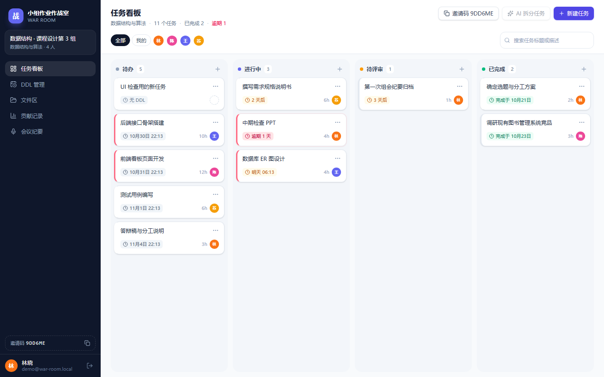

---

## 目录

- [它解决什么问题](#它解决什么问题)
- [核心功能](#核心功能)
- [AI 权限模型（BYOK）](#ai-权限模型byok)
- [技术栈](#技术栈)
- [本地运行](#本地运行)
- [环境变量说明](#环境变量说明)
- [常用命令](#常用命令)
- [界面预览](#界面预览)
- [部署到 Railway](#部署到-railway)
- [数据与目录结构](#数据与目录结构)
- [测试](#测试)
- [安全设计](#安全设计)
- [常见问题](#常见问题)

---

## 它解决什么问题

| 小组作业的真实痛点 | 本项目的做法 |
| --- | --- |
| 任务只活在微信聊天里，谁在做、做到哪一步没人清楚 | 四列看板（待办 / 进行中 / 待评审 / 已完成），拖拽流转，实时同步 |
| DDL 靠人肉记，总有人最后一晚才想起 | 建任务即可设截止时间，逾期 / 24h / 1h 自动提醒（站内推送） |
| 文件散落在群聊、网盘、U 盘里，交作业时互相找 | 文件区统一上传下载，可关联到具体任务作为"产出物"，带版本号 |
| 小组作业最怕"搭便车"，但贡献说不清 | 贡献记录按事件自动计分，图表 + CSV 导出，答辩可直接交给老师 |
| 开会一小时，纪要没人写、任务没人落 | 录音 → 自动转写 → AI 生成纪要 → 行动项一键转任务 |

## 核心功能

| 模块 | 说明 |
| --- | --- |
| **任务看板** | 四列拖拽、列内排序、按人筛选、关键词搜索、任务详情抽屉（动态流 + 评论 + 编辑）；**只有组长能把任务移入「已完成」** |
| **DDL 管理** | 列表按「逾期 / 今天 / 明天 / 7 天内 / 更晚」分组，月历视图；24h 与 1h 两级提醒 |
| **文件区** | 拖拽多文件上传、进度条、关联任务、版本号、下载计数、鉴权下载；**除可执行/脚本外几乎任意格式（含 avif/heic）**，单文件 ≤ 200MB |
| **贡献记录** | 事件表自动计分（完成 10 / 评审 4 / 文件 2 / 评论 1）、成员排行、计分占比、8 周趋势、CSV 导出、A4 单页打印 |
| **会议纪要** | 录音或上传音频 → 语音转写 → 可编辑逐字稿 → AI 纪要（摘要/决议/行动项/风险）→ 勾选行动项转任务 |
| **AI 任务拆分** | 一句话目标 → 4–8 条任务草稿（含优先级/工时建议）→ 逐条修改 → 确认后批量落库 |
| **实时同步** | SSE 推送：任何人改任务 / 传文件 / 发评论，其他人 250ms 内自动刷新 |

## AI 权限模型（BYOK）

系统对 AI 能力做了两级设计：既能让老师统一配额，也允许同学自带 Key：

| 能力 | 谁能用 | 用谁的额度 |
| --- | --- | --- |
| **语音转写（ASR）** | 所有登录用户 | 平台 `.env` 里的公用 `ASR_API_KEY`（用户无需配置） |
| **AI 纪要 / AI 任务拆分（LLM）** | ① 设置页配置了自己的 DeepSeek Key；② 或已被管理员授权 | ① 自己的 Key（不受平台额度限制）② 平台公用 `AI_API_KEY` |

- 两者都没有 → 接口 403「请先输入 AI 授权码，或在设置中配置您的 API Key」，前端按钮置灰并引导到设置页。
- 授权码由环境变量 `AI_ACTIVATION_CODE` 配置；**生产环境不配置则关闭自助开通**（防止默认码被滥用）。
- 用户自带的 Key 经 **AES-256-GCM 加密**存库，接口只回传脱敏尾号（如 `sk-abcd…wxyz`），管理员也看不到明文。
- 管理命令：`npm run grant:ai -- <邮箱>` 直接开通 / 收回，`npm run reset:password -- <邮箱> <新密码>` 重置密码。

> 不配任何 Key 也能完整跑通：自动进入**演示模式**，AI 返回内置样例并在页面标注「演示样例，请核对」。答辩断网也能演示。

## 技术栈

| 层 | 选型 | 说明 |
| --- | --- | --- |
| 前端 | **React 19 + Vite 8 + TypeScript** | 单页应用，桌面 + 移动端自适应 |
| 前端状态/请求 | TanStack Query 5、React Router 7 | 缓存、自动重试、乐观更新 |
| 样式 | **Tailwind CSS 4** | 无组件库，全部手写；打印样式用 `@media print` |
| 拖拽 | dnd-kit | 看板拖拽与列内排序 |
| 后端 | **Node.js 24 + Fastify 5 + TypeScript** | 单进程同时提供 `/api` 与前端静态文件；`tsx` 直跑 TS，无构建步骤 |
| 数据校验 | **Zod 4**（`packages/shared`） | 前后端共用同一份 schema 与类型，契约不用各写一遍 |
| 数据库 | **SQLite（Node 内置 `node:sqlite`）** | **不使用 Prisma**：见下方说明 |
| 实时 | **SSE**（Server-Sent Events） | 比 WebSocket 简单，走 HTTP 长连接，25s 心跳 |
| AI | OpenAI 兼容协议 | 文本走 `/chat/completions`（默认 DeepSeek），语音走 `/audio/transcriptions`；JSON 输出 Zod 校验 + 失败重试 |
| 部署 | **Docker 单进程 + Railway Volume** | 前端产物由 Fastify 托管，SQLite 与上传文件落在 `/data` |

> **为什么不用 Prisma**：Prisma 需要额外的 query engine 二进制和 `prisma generate`，在 Alpine / 受限网络里容易失配；本项目用 `node:sqlite` + 手写 `schema.sql`，`npm ci` 后即可运行，容器体积与启动链路都更短。数据访问层集中在 `apps/api/src/db/`，将来要换 ORM 也只动这一层。

## 本地运行

> **环境要求：Node.js ≥ 24**（使用内置 `node:sqlite`；Node 22 需实验性 flag，不推荐）。仓库根目录有 `.nvmrc`。

```bash
# 1. 拉代码、装依赖
git clone <your-repo-url> war-room
cd war-room
npm install

# 2. 配置环境变量（不配也能以演示模式运行）
cp .env.example .env

# 3. 生成演示数据（4 人小组 + 10 个任务 + 1 场已生成的会议纪要）
npm run seed

# 4. 启动（API :4000 + 前端 :5173，Vite 自动代理 /api）
npm run dev
```

打开 <http://localhost:5173>，演示账号：`demo@war-room.local` / `demo1234`
（其他成员：`chen@` / `wang@` / `su@war-room.local`，密码相同）。

**想直接跑生产形态（单端口）**：

```bash
npm run build     # 构建前端到 apps/web/dist
npm start         # Fastify 同时托管 /api 与静态文件：http://localhost:4000
```

## 环境变量说明

`.env` 只在**仓库根目录**读取（启动参数 `--env-file-if-exists=../../.env`），改完必须重启进程。

### 按使用模式选择

| 你要的效果 | 需要配置 |
| --- | --- |
| 纯演示（AI 返回样例） | 什么都不配，或 `AI_PROVIDER=mock` |
| 真 AI（平台公用 Key + 授权） | `AI_API_KEY` + `AI_BASE_URL` + `AI_MODEL`，以及 `AI_ACTIVATION_CODE` |
| 真实语音转写 | `ASR_API_KEY` + `ASR_BASE_URL` + `ASR_MODEL` |
| 同学自带 Key（BYOK） | 你什么都不用配，同学在设置页填自己的 DeepSeek Key |

### 完整变量表

| 变量 | 默认值 | 说明 |
| --- | --- | --- |
| `AI_API_KEY` / `AI_BASE_URL` / `AI_MODEL` | 空 / `https://api.deepseek.com/v1` / `deepseek-chat` | 文本大模型（任务拆分、会议纪要） |
| `ASR_API_KEY` / `ASR_BASE_URL` / `ASR_MODEL` | 空 / 空 / `whisper-1` | 语音识别，需 OpenAI 兼容的 `/audio/transcriptions` |
| `AI_PROVIDER` | 空 | 设为 `mock` 强制演示模式（即使配了 Key 也不发真实请求） |
| `AI_ACTIVATION_CODE` | 开发环境 `war-room-vip`；**生产环境为空（关闭自助开通）** | 用户在设置页输入的 AI 授权码 |
| `AI_MAX_CONCURRENT` | `3` | 同时最多几个 AI/ASR 调用，防内存打爆 |
| `AI_TIMEOUT_MS` / `ASR_TIMEOUT_MS` | `45000` / `120000` | 调用超时，超时返回友好错误而非挂死 |
| `AUTH_SECRET` | 自动生成到 `DATA_DIR/.auth-secret` | 会话签名密钥；**生产必须固定**，否则容器重建后全员掉线 |
| `KEY_ENC_SECRET` | 回退到 `AUTH_SECRET` | BYOK Key 的加密密钥；设置后不要随意更换 |
| `DATA_DIR` | `apps/api/data`（Docker 里是 `/data`） | SQLite、上传文件、密钥存放目录 |
| `PORT` / `HOST` | `4000` / `0.0.0.0` | 监听地址 |
| `COOKIE_SECURE` | 生产 `true` | 通过 HTTPS 访问时必须 `true`，否则浏览器不保存登录态 |
| `MAX_UPLOAD_BYTES` | `209715200`（200MB） | 单文件上限 |
| `RATE_LIMIT_AUTH_PER_MIN` / `RATE_LIMIT_AI_PER_MIN` | `40` / `20` | 登录注册、AI 调用的限流阈值 |
| `REGISTER_ENABLED` | `true` | 设为 `false` 关闭自助注册（只允许邀请码加入） |
| `LOG_LEVEL` | `info` | Fastify 日志级别 |

## 常用命令

| 命令 | 作用 |
| --- | --- |
| `npm run dev` / `dev:api` / `dev:web` | 同时起前后端 / 只起接口 / 只起前端 |
| `npm run build` / `npm start` | 构建前端 / 单端口生产启动 |
| `npm run seed` | 生成演示数据（幂等，已存在则跳过） |
| `npm run typecheck` | 前后端 `tsc --noEmit` |
| `npm run smoke` / `check:p1` / `check:p2` / `check:p3` | 四套接口自检（共 141 项断言） |
| `npm run reset:password -- <邮箱> <新密码>` | 重置账号密码（`-- --list` 查看所有账号） |
| `npm run grant:ai -- <邮箱> [--revoke]` | 后台开通 / 收回 AI 权限 |
| `npm run env:check` | 检查 `.env` 是否加载、AI 变量状态（值已脱敏） |
| `npm run stub:llm` | 起本地假大模型接口，验证真实调用链路 |

## 界面预览

> 截图都放在 `docs/screenshots/`，由无头浏览器自动生成；替换时保持文件名不变即可。

| 任务看板 | 任务详情 |
| --- | --- |
|  | 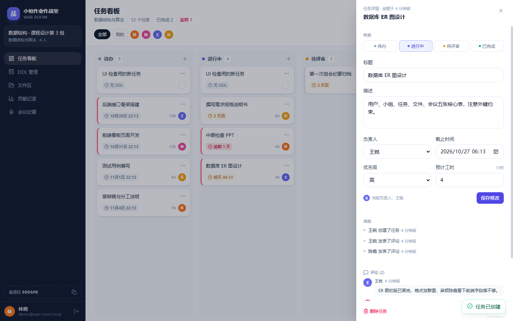 |

| DDL 列表 | DDL 日历 |
| --- | --- |
| 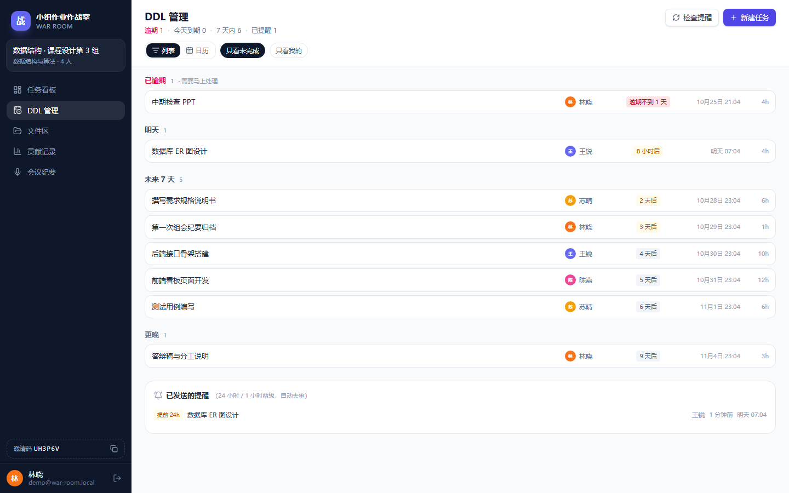 | 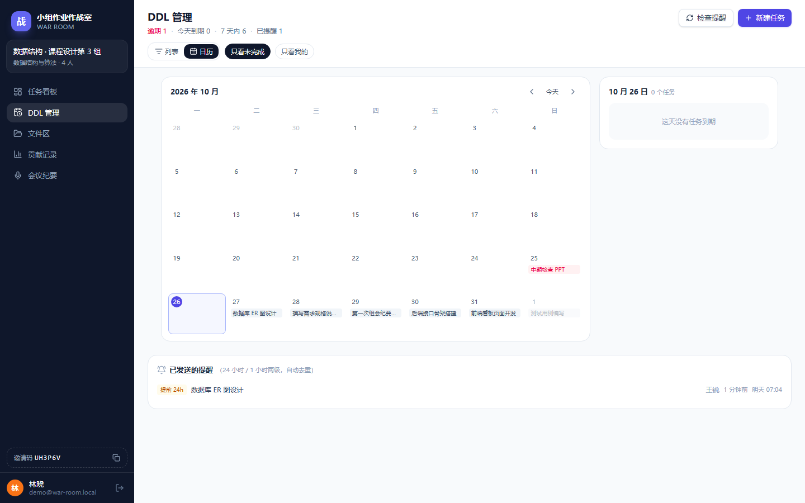 |

| 文件区 | AI 任务拆分 |
| --- | --- |
| 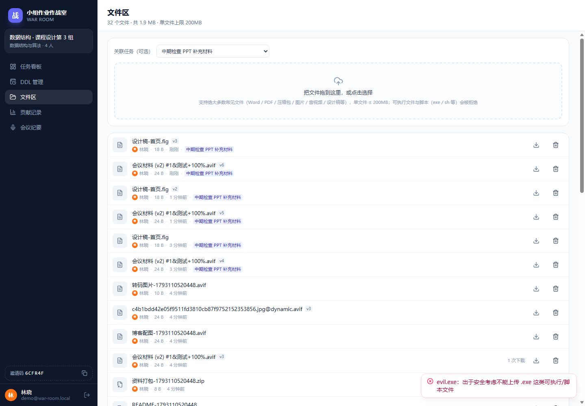 | 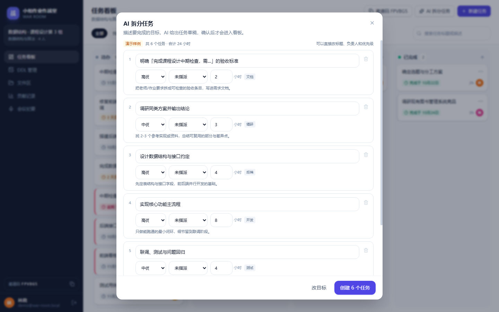 |

**贡献记录（图表 + CSV + 打印）**

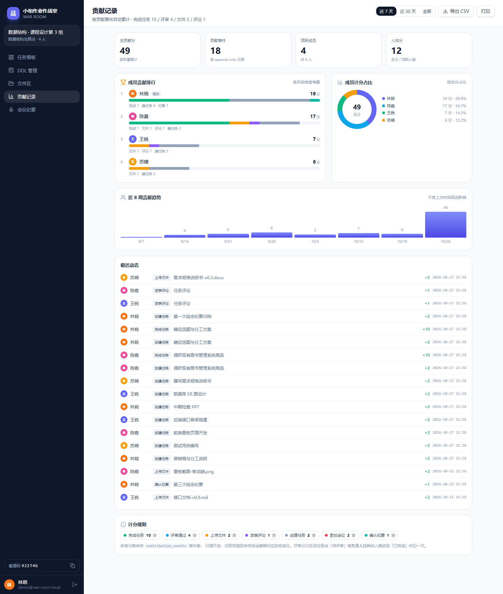

**会议纪要（完整链路）**

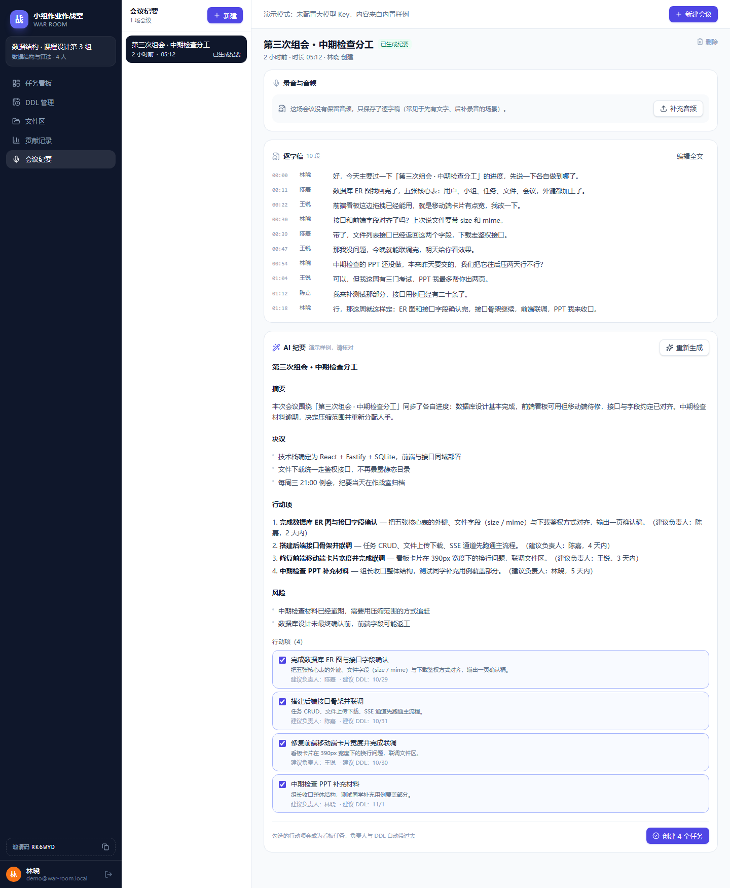

| 移动端看板 | 移动端 DDL | 移动端会议 |
| --- | --- | --- |
| 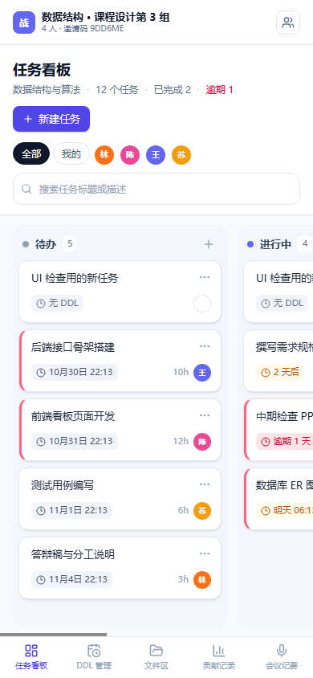 | 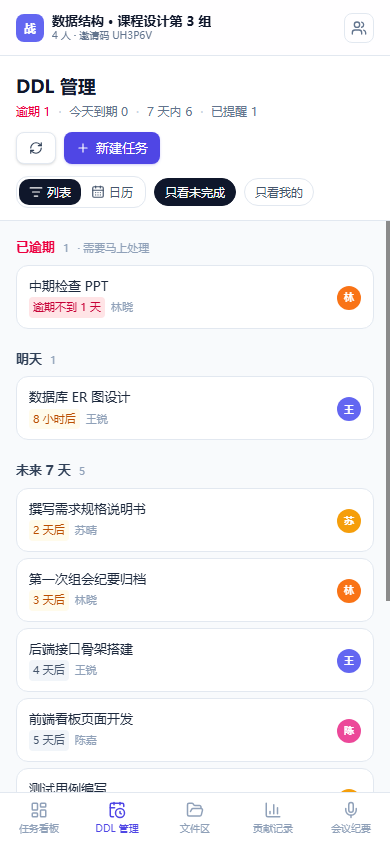 | 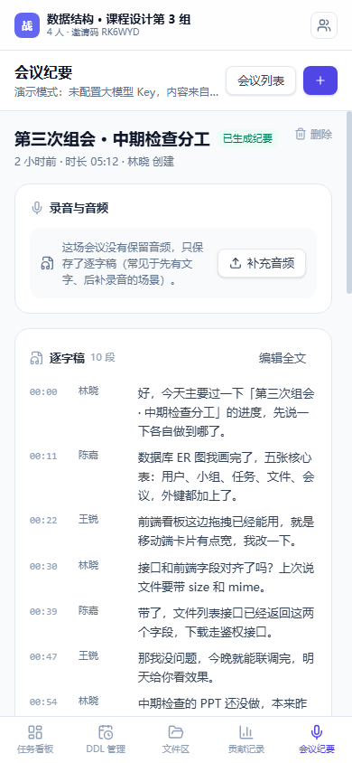 |

## 部署到 Railway

### 为什么是 Railway

本项目需要 **长驻进程 + 持久化磁盘 + SSE 长连接**，适合 Railway / Render / Fly.io / 自备 VPS。
**Vercel 不适配**：无持久文件系统（SQLite 与上传文件无处落盘）、Serverless 不适合 SSE 长连接、请求体上限 4.5MB。

### 步骤

1. **推代码到 GitHub**（仓库根目录就是项目根目录，包含 `Dockerfile`）。
2. <https://railway.app> → **New Project → Deploy from GitHub repo** → 选择仓库。
   Railway 自动识别根目录 `Dockerfile`（构建流程：`npm ci` → `npm run build`）。
3. **添加 Volume（关键）**：服务 → **Settings → Volumes → Add Volume**，
   **Mount path 填 `/data`** —— 必须与 `DATA_DIR` 一致，否则重启后数据全丢。
4. **配置环境变量**（Settings → Variables）：

   | 变量 | 值 | 必填 |
   | --- | --- | --- |
   | `DATA_DIR` | `/data` | ✅ |
   | `COOKIE_SECURE` | `true` | ✅（HTTPS 环境） |
   | `AUTH_SECRET` | 32 字节以上随机串 | ✅（否则每次部署全员掉线） |
   | `AI_API_KEY` / `AI_BASE_URL` / `AI_MODEL` | 文本模型 Key | 想用平台公用 AI 时 |
   | `ASR_API_KEY` / `ASR_BASE_URL` / `ASR_MODEL` | 语音识别 Key | 想用语音转写时 |
   | `AI_ACTIVATION_CODE` | 自定义授权码 | 想让用户自助开通 AI 时 |

   > `NODE_ENV=production`、`PORT`、`HOST` 已由 Dockerfile 设好，不必重复配置。
5. **生成域名**：Settings → **Networking → Generate Domain**，得到 `https://xxx.up.railway.app`。
6. **验证**：访问 `/api/health` 应返回 `{"ok":true,...}`；打开首页能注册/登录。

### 关于 CORS

本项目**不需要 CORS 配置**：前端构建产物由同一个 Fastify 进程托管，前后端同源，所有请求都是相对路径 `/api/...`。
只有当你想把前端单独部署到另一个域名时，才需要引入 `@fastify/cors` 并把部署域名加入白名单。

### 首启注意

- 容器首次启动会在 `/data` 自动建库建表，**不要执行 `npm run seed`**（那是本地演示数据，含公开的演示账号）。
- 想让第一批人能用：直接注册账号即可（默认开放注册）；不希望陌生人注册就设 `REGISTER_ENABLED=false`。
- 想给某人开 AI 权限又不想发授权码：容器内执行 `npm run grant:ai -- <邮箱>`。

### 其它平台

- **Render**：需要付费 Starter 才能挂载磁盘。
- **Fly.io**：`fly volumes create` + 挂载到 `/data` 即可。
- **自备 VPS**：`docker run -e DATA_DIR=/data -v /opt/war-room/data:/data ...`；
  Nginx 反代必须 `proxy_buffering off;`（否则 SSE 实时推送会卡住）、`client_max_body_size 210m;`。
  详见 [docs/DEPLOY.md](docs/DEPLOY.md) 与 [docs/DEPLOY-STEP-BY-STEP.md](docs/DEPLOY-STEP-BY-STEP.md)。

## 数据与目录结构

```
war-room/
├─ apps/api/                  # Fastify 后端（tsx 直跑 TS）
│  ├─ src/
│  │  ├─ app.ts               # 组装：安全头、错误处理、静态托管、提醒定时器
│  │  ├─ routes/              # auth/groups/tasks/files/meetings/contributions/ai/events
│  │  ├─ services/            # 业务逻辑（任务、文件、会议、贡献聚合…）
│  │  ├─ ai/                  # 大模型接入（client / prompts / mock / jobs）
│  │  ├─ lib/                 # 会话、口令、限流、BYOK 加密、AI 凭据解析
│  │  └─ db/                  # node:sqlite 连接 + 事务 + schema.sql
│  └─ data/                   # 本地运行数据（已 gitignore）
├─ apps/web/                  # React 前端
│  └─ src/{pages,components,hooks,lib}
├─ packages/shared/           # Zod schema + 类型 + 常量（前后端唯一契约）
├─ scripts/                   # 自检脚本、seed、reset-password、grant-ai、stub-llm
├─ docs/                      # 部署文档 + 截图
├─ Dockerfile / railway.json  # 部署
└─ .env.example               # 环境变量模板
```

核心数据表：`users`（含 `can_use_ai`、加密的 `user_deepseek_key`）、`teams`（小组，表名避开 SQL 关键字）、
`memberships`、`tasks`、`comments`、`activities`、`files`、`meetings`、`contribution_events`（append-only 计分事实来源）、
`reminders`、`ai_jobs`（每次 AI 调用记账）。

## 测试

四套自检脚本都是「真 HTTP 请求 + 退出码」，不依赖测试框架：

| 脚本 | 覆盖 | 断言 |
| --- | --- | --- |
| `npm run smoke` | 注册 / 建组 / 任务流转 / 409 冲突 / 403 越权 / SSE 广播 / 会话失效 | 22 |
| `npm run check:p1` | 提醒扫描去重 / 文件上传下载 / 扩展名黑名单与魔数 / AVIF / 特殊字符文件名 / 上传上限 | 29 |
| `npm run check:p2` | AI 授权门槛 / BYOK（保存·脱敏·优先级·清除）/ ASR 公用 / 拆分 / 转写 / 纪要 / 行动项转任务 | 46 |
| `npm run check:p3` | 贡献事件埋点 / 四类权重 / 完成分归属 / 组长验收权限 / 汇总维度 / CSV / 打印口径 | 44 |

**合计 141 项**；另有 60+ 项前端端到端检查（无头浏览器驱动，仓库里的截图就是它生成的）。

## 安全设计

| 项 | 做法 |
| --- | --- |
| 会话 | HttpOnly + SameSite=Lax Cookie，生产强制 `Secure`，HS256 签名（`timingSafeEqual` 校验） |
| 口令 | scrypt + 16 字节随机盐，绝不存明文 |
| SQL 注入 | 全部参数化查询，无字符串拼接用户输入 |
| XSS | 前端不用 `dangerouslySetInnerHTML`（纪要用 React 文本节点渲染）；统一 CSP + `nosniff` + `X-Frame-Options` |
| 越权 | 资源级接口先反查 `group_id` 再校验成员身份，跨组访问 403 |
| 上传 | 扩展名黑名单（拦 exe/sh 等）+ 魔数嗅探（改名的 exe 也会被识别）+ 三重体积拦截 |
| 敏感数据 | 用户自带 Key 用 AES-256-GCM 加密存储；`.env` 与 `data/` 均被 `.gitignore` / `.dockerignore` 排除 |
| 限流 | 登录 / 注册 / 邀请码按 IP，AI 调用按用户，超限返回 429 |
| 运维 | 健康检查真实探测数据库；进程级崩溃兜底；优雅关闭时主动断开 SSE |

## 常见问题

**改了 `.env` 不生效？** 只在进程启动时读一次，改完要重启；且只读仓库根目录的 `.env`。用 `npm run env:check` 可确认。

**AI 功能点了没反应 / 提示未授权？** 去设置页输入授权码，或填入自己的 DeepSeek Key；也可以让管理员执行 `npm run grant:ai -- <你的邮箱>`。

**授权码明明配了却提示不正确？** 启动日志会打印「授权码: 已从环境变量读取 / 内置默认值」。若是后者，说明变量没被读到（确认写在仓库根目录 `.env` 并重启）。

**上传大文件返回 413？** 单文件上限 200MB；若前面挂了 Nginx，记得 `client_max_body_size 210m`。

**部署后能登录但刷新就掉线？** 多半是 `COOKIE_SECURE=true` 却在用 HTTP 访问；请用 HTTPS 域名，或本地调试时设 `COOKIE_SECURE=false`。

**重启后数据没了？** Volume 没挂或没挂到 `/data`，与 `DATA_DIR` 不一致。

## License

课程项目，未指定开源协议；如需引用请先联系作者。
